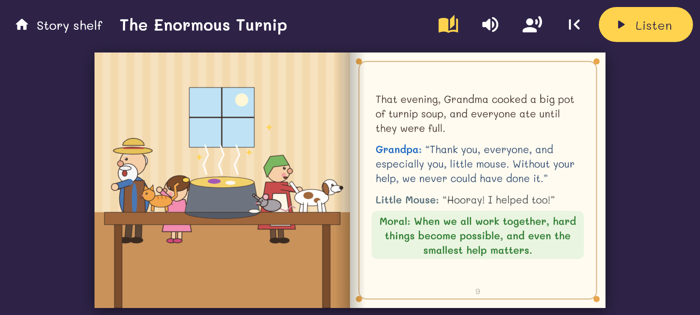

# Pagelume Tales

Picture story books that turn like real pages and read themselves aloud.
The picture is on the left page and the words on the right. Built on the
page-turn engine of [Pagelume](https://github.com/attasakj-blip/pdf-flip-reader).

- **Stories:** public-domain folk tales, retold in our own words in English.
  First story: *The Enormous Turnip*. Menus are in 23 languages (`tools/ui_strings.py`).
- **Read aloud:** uses the phone's own English text-to-speech (free, offline).
  The reader can pick a phone voice for each character (saved); each character
  also has its own pitch and speed. The line being read is
  highlighted, and the page turns by itself at the end (can be switched off).
- **Pictures:** drawn from simple shapes by `tools/make_art.py`, so they are ours to use.

## Adding a story
1. Make a folder `assets/stories/<id>/` with `story.json` (see the turnip one)
   and one picture per page (`p00.png` is the cover). Set `pageAspect`
   (height / width) to the pictures' shape; other shapes are cropped to fit.
2. Add the folder to `storyFolders` in `lib/story.dart` and to `assets:` in `pubspec.yaml`.

## Build
GitHub Actions builds the APKs on every push to `main` and attaches them to the
release named `latest`. `flutter test` also writes screenshots to `build/shots/`.

Character voice types: young woman, young man, middle-aged woman, middle-aged
man, girl, boy, elderly woman, elderly man (`voice` in `story.json`).

