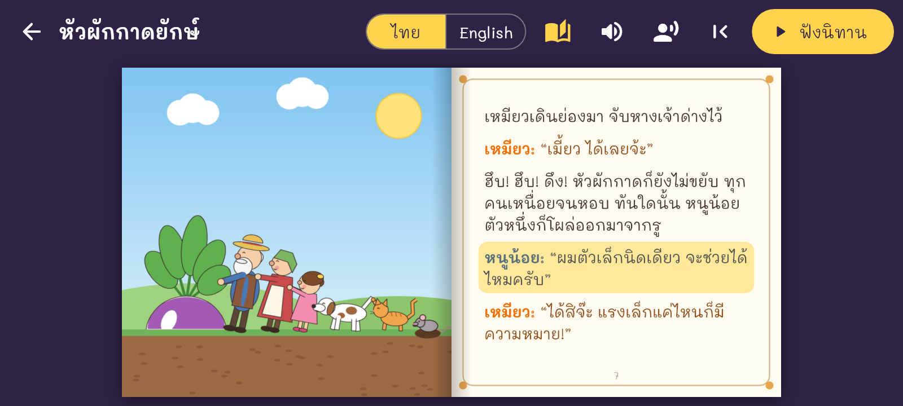

# Pagelume Tales

Picture story books that turn like real pages and read themselves aloud.
The picture is on the left page and the words on the right. Built on the
page-turn engine of [Pagelume](https://github.com/attasakj-blip/pdf-flip-reader).

- **Stories:** public-domain folk tales, retold in our own words in Thai and English.
  First story: *The Enormous Turnip* (หัวผักกาดยักษ์).
- **Read aloud:** uses the phone's own text-to-speech (free, offline once the
  language is installed). Each character has its own pitch and speed, and male
  characters use a male voice when the phone has one. The line being read is
  highlighted, and the page turns by itself at the end (can be switched off).
- **Pictures:** drawn from simple shapes by `tools/make_art.py`, so they are ours to use.

## Adding a story
1. Make a folder `assets/stories/<id>/` with `story.json` (see the turnip one)
   and one square picture per page (`p00.png` is the cover).
2. Add the folder to `storyFolders` in `lib/story.dart` and to `assets:` in `pubspec.yaml`.

## Build
GitHub Actions builds the APKs on every push to `main` and attaches them to the
release named `latest`. `flutter test` also writes screenshots to `build/shots/`.

Character voice types: young woman, young man, middle-aged woman, middle-aged
man, girl, boy, elderly woman, elderly man (`voice` in `story.json`).

